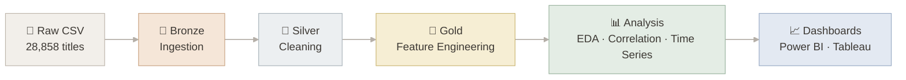

<h1 align="center">🎌 Anime Engagement & Popularity Dynamics</h1>

  <b>Medallion Architecture • Feature Engineering • Statistical Analysis • BI Dashboards</b>

  
  
  
  
  
  

## ⛩️ Executive Summary

Anime production doubled during the streaming boom. That raises two simple questions:

> **Did making more anime lead to better anime?** 
> **And do the best-rated shows actually become the most popular?**

To find out, I built an end-to-end data pipeline on **3,818 anime titles from MyAnimeList (2010–2025)**. It starts with raw data in Databricks and ends with interactive Power BI and Tableau dashboards.

**🎯 The Short Answer: The Anime Quality Paradox**

- 📉 **More anime didn't mean better anime.** Quality hit its lowest point in 2017, the same time production peaked.
- ⭐ **Popular doesn't always mean good.** Big franchises stay popular even when a season is weak, while many top-rated shows stay unknown.
- 📊 **Quality helps, but it isn't everything.** Better-rated shows do get more viewers, but quality explains only part of the story.
- 🌸 **Quality is bouncing back.** Shows from 2021–2025 are the best-rated of any period in the data.

## 🌐 About the Project

Streaming platforms like Crunchyroll and Netflix took anime worldwide, and studios responded by producing far more: from **~140 titles in 2010** to **~280 a year by 2016–2017**. This project looks at what that growth did to quality, and whether audiences reward good shows or just familiar names.

| | |
|---|---|
| **Project Type** | End-to-end data analytics |
| **Domain** | Media & Entertainment |
| **Data** | MyAnimeList: 28,858 titles, narrowed to 3,818 (2010–2025) |
| **Platform** | Databricks Community Edition |

## 🔧 What I Did

The project follows the **Medallion Architecture**, a common data engineering pattern. Data moves through three layers and gets cleaner and more useful at each step.

  

### 1️⃣ Bronze Layer: Getting the Raw Data In

I loaded the full MyAnimeList dataset (**28,858 titles**) into Databricks as it was, untouched. Anime titles often contain special characters, quotes and line breaks, so the loader was set up to handle those without breaking any records.

### 2️⃣ Silver Layer: Cleaning the Data

Raw data is messy, so this step made it reliable:

- Kept the **21 columns** needed for analysis and dropped the rest (like image links)
- Filtered to titles from **2010 onward**, which leaves **3,818 titles**
- Fixed data types, trimmed extra spaces and removed duplicate entries
- Filled in missing values sensibly (see below)

<b>📋 How missing values were handled</b>

 

| Column | Missing | What I Did |
|---|:---:|---|
| demographics | 56.87% | Marked as "Unknown" |
| title_english | 30.35% | Used the original Japanese title |
| themes | 28.33% | Marked as "None" |
| score / scored_by | 21.25% | Set to 0 |
| studios | 12.83% | Marked as "Unknown" |
| genres | 6.01% | Marked as "Unknown" |
| episodes | 4.04% | Used the median (12 episodes, a typical season) |

> 💡 **Why set missing scores to 0 instead of the average?** If I gave unrated shows an average score, they'd look better than they really are. Instead, I set them to 0 and left them out of every score calculation.

### 3️⃣ Gold Layer: Creating Smarter Metrics

Raw numbers like "members" and "score" don't tell the full story. So I created six new metrics that measure engagement, loyalty and quality more meaningfully:

| Feature | Formula | What It Tells Us |
|---|---|---|
| `engagement_score` | `log(members) + log(favorites+1)` | Overall audience interest; log scale tames huge outliers |
| `score_z` | `(score − mean) / std` | How a show's quality compares to the average (scored titles only) |
| `popularity_momentum` | `members / (scored_by+1)` | High = casual/viral reach · Low = dedicated fanbase |
| `retention_proxy` | `favorites / (members+1)` | Share of viewers who became loyal fans |
| `score_tier` | Score buckets | Excellent ≥8.0 · Good ≥7.0 · Average ≥6.0 · Below Average >0 · Unscored |
| `airing_era` | Year groups | Digital Boom (2010–12) · Streaming Revolution (2013–16) · Global Expansion (2017–20) · Modern Renaissance (2021+) |

> 💡 **What is `score_z`?** It shows how far a show is above or below the average. **0** means exactly average, a **positive** number means better than average, and a **negative** number means worse.

### 4️⃣ Analysis: Finding the Answers

- **Exploratory analysis:** 17 questions on score patterns, yearly trends, genres, studios, hidden gems and overhyped shows
- **Correlation analysis:** measured how strongly quality and popularity are linked, overall and for each genre. Only titles with 1,000+ ratings were used, so the results are reliable.
- **Time series analysis:** tracked how production and quality changed year by year

### 5️⃣ Dashboards: Making It Easy to Explore

- **Power BI (3 pages):** project overview, KPI dashboard with filters, and trend analysis
- **Tableau (5-slide story):** walks through the findings, from Growth vs. Quality to Hidden Gems

## 📈 Key Results

### 📊 Does Quality Predict Popularity?

<table>
<tr>
<td valign="top">

| Metric | Value |
|---|:---:|
| Pearson r | **0.567** |
| Spearman r | **0.568** |
| p-value | **< 0.001** |

</td>
<td valign="top">

- **r** measures how strongly two things are linked, from 0 (no link) to 1 (perfect link).
- **~0.57 is a moderate link.** Better shows do tend to get more viewers, but it's far from guaranteed.
- **p < 0.001** means this pattern is almost certainly real, not a coincidence.

</td>
</tr>
</table>

> ✅ **In plain words:** quality matters, but it's only part of the story. Franchise name, genre and visibility play a big role in what becomes popular.

### 🏆 Quality at a Glance

<table>
<tr>
<td valign="top">

| Metric | Value |
|---|:---:|
| Rated Excellent (8.0+) | **Only 8%** |
| Worst year | **2017**: avg 6.61 |
| Best year | **2024**: avg 7.06 |
| Top genre | **Drama**: avg 7.28 |
| Top studio | **Ufotable**: avg 7.98 |

</td>
<td valign="top">

- Scores are out of **10**, based on MyAnimeList user ratings.
- Only about **1 in 12** shows reaches the Excellent level.
- Quality dropped to its lowest in **2017**, then climbed back **+0.45 points** by 2024.
- Genres with fewer titles, like **Drama**, tend to score higher.

</td>
</tr>
</table>

### 🌸 Quality Across the Years

<table>
<tr>
<td valign="top">

| Era | Score Z |
|---|:---:|
| Digital Boom (2010–12) | +0.140 ✅ |
| Streaming Revolution (2013–16) | −0.115 ❌ |
| Global Expansion (2017–20) | −0.133 ❌ |
| **Modern Renaissance (2021–25)** | **+0.143 🏆** |

</td>
<td valign="top">

- **Positive** = better than average · **Negative** = worse than average
- As streaming grew and studios rushed out more shows, **quality fell**.
- Once production slowed after 2020, **quality recovered** and reached its best level yet.

</td>
</tr>
</table>

### 🎭 Does It Depend on the Genre?

<table>
<tr>
<td valign="top">

| Genre | Link (r) |
|---|:---:|
| Sports | 0.633 |
| Supernatural | 0.628 |
| Sci-Fi | 0.603 |
| Action | 0.551 |
| Romance | 0.441 |

</td>
<td valign="top">

- A **higher r** means quality matters more for popularity in that genre.
- In **Sports and Sci-Fi**, good shows clearly win more fans.
- In **Romance**, fans keep watching whether a show is rated well or not.

</td>
</tr>
</table>

## 🔍 Key Insights

- **Excellence is rare:** only 8% of titles score 8.0+, but quality has been improving since 2017.
- **Too many shows dilute quality:** Comedy has 1,478 titles averaging 6.85, while Drama has just 411 averaging 7.28.
- **Fans stay loyal to franchises:** *Neverland Season 2* dropped from 8.70 to 5.25, yet still kept 973K members.
- **Great shows can stay hidden:** *Chiikawa* (8.26) and *Pui Pui Molcar* (8.01) are rated highly but have under 20K members.

## 🏁 Recommendations

- **For studios:** make fewer, better shows. Invest in Drama, Suspense and Mystery, and protect sequel quality.
- **For streaming platforms:** promote hidden gems in recommendations and back quality over volume.
- **For analysts:** watch production volume closely, because a sharp rise often comes before a drop in quality.

## ⚠️ Limitations

- The data comes only from MyAnimeList, whose users are mostly active online fans.
- Shows from 2024–2025 are still collecting ratings, so their numbers may change.
- Member counts add up over time and don't show *when* people started watching.
- 2026 is excluded from trend analysis because the year isn't complete.

---

DESIGNED & DEVELOPED BY

## Karthick S

⭐ Star this repo if you found it useful

